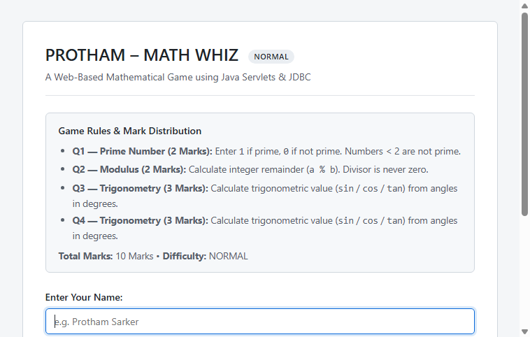
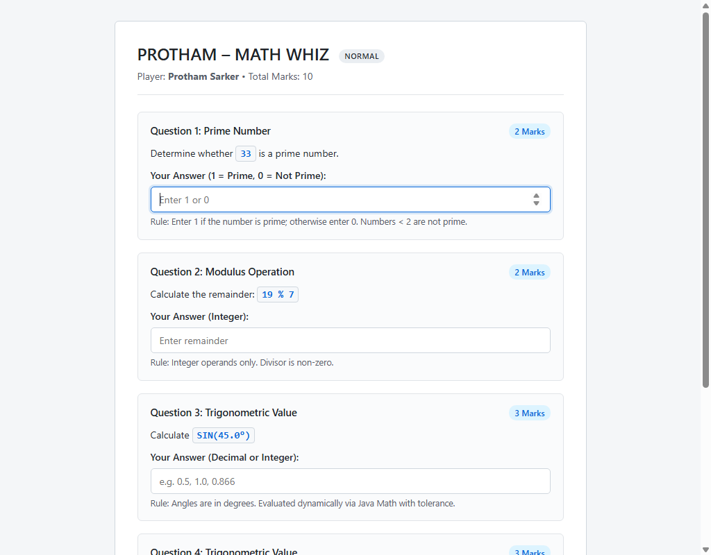
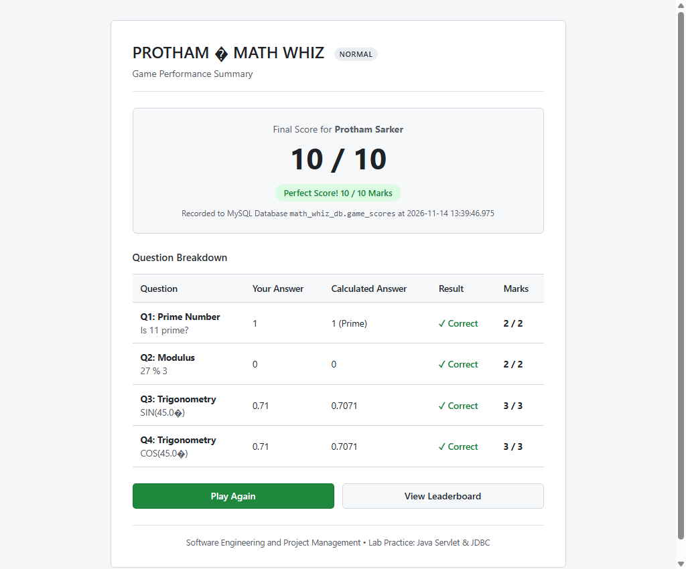
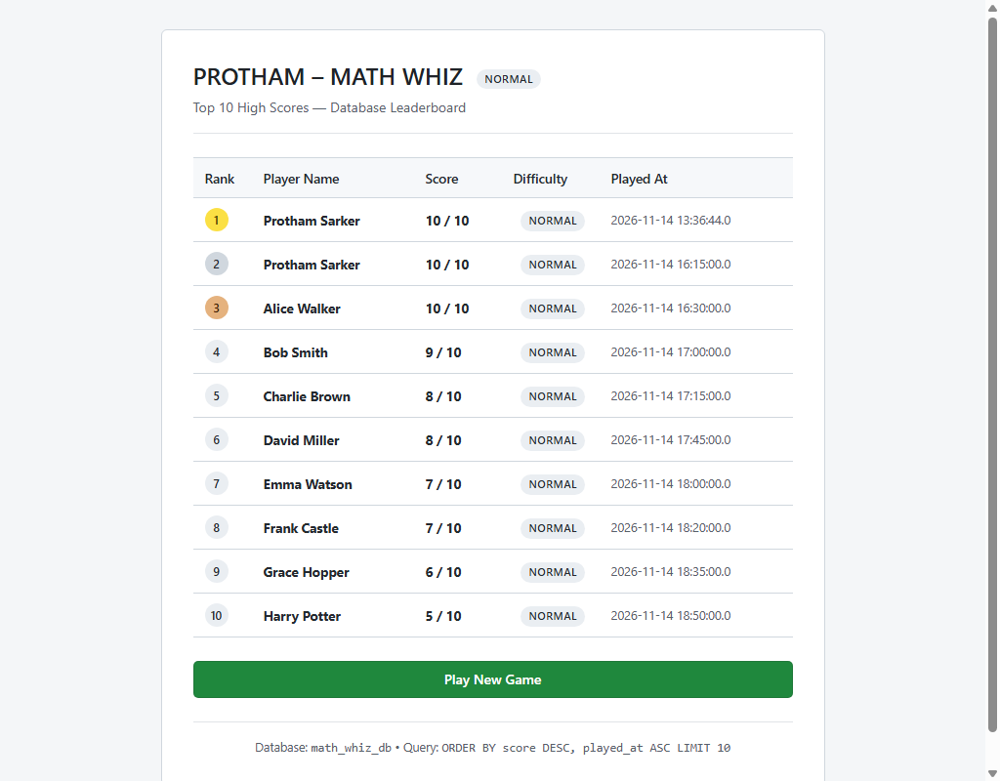

# PROTHAM – MATH WHIZ
### Practical Lab Practice: Java Servlet & JDBC Web Application

---

## Student Information

| Field | Details |
|---|---|
| **Student Name** | Protham Sarker |
| **Course** | Software Engineering and Project Management |
| **Assignment** | Lab Practice: Java Servlet & JDBC (Mathematical Web Game) |
| **Project Title** | PROTHAM – MATH WHIZ |
| **Programming Language** | Pure Java (Jakarta EE / Servlet API & JDBC) |
| **GitHub Directory** | [PROTHAM-MATH WHIZ](https://github.com/prothamsarker/SOFTWARE-ENGINEERING_AND_PROJECT-MANAGEMENT/tree/main/ASSIGNMENTS/PROTHAM-MATH%20WHIZ) |

---

## 01 Project Overview & Objectives

**PROTHAM – MATH WHIZ** is a server-side web application developed using pure Java, Java Servlets (Jakarta EE), JavaServer Pages (JSP), JDBC (Java Database Connectivity), and a MySQL database backend.

The application presents players with four mathematical challenges spanning three core disciplines:
1. **Prime Number Verification**: Determine whether a given integer is prime.
2. **Modulus Arithmetic**: Calculate integer division remainders with division-by-zero protection.
3. **Trigonometry**: Dynamically compute sine, cosine, or tangent of angles in degrees.

### Key Objectives
- Implement modular, reusable Java methods to dynamically calculate mathematical answers on the server rather than relying on hardcoded responses.
- Process HTTP GET and POST requests through Java Servlets and forward presentation logic cleanly to JSPs.
- Establish secure JDBC connectivity to MySQL using `PreparedStatement` to store and query game records.
- Implement an automated Top 10 leaderboard sorted by highest score with timestamp-based tie breaking.
- Maintain a clean, minimalistic, student-crafted UI that is completely free of artificial/generic generator styling.

---

## 02 Technologies & Software Requirements

| Category | Technology / Tool | Version |
|---|---|---|
| **IDE** | IntelliJ IDEA Ultimate | 2024+ |
| **Java JDK** | OpenJDK / Temurin | 21 (LTS) |
| **Server Framework** | Jakarta Servlet & JSP API | 6.0.0 / 3.1.0 |
| **Web Server** | Apache Tomcat | 10.1.61 |
| **Database** | MySQL Community Server | 26.10 / 8.0+ |
| **JDBC Driver** | MySQL Connector/J | 9.1.0 |
| **Build Automation** | Apache Maven | 3.10.0 (Wrapper included) |
| **Testing Framework** | JUnit 4 | 4.13.2 |
| **Operating System** | Windows 11 | x64 |

---

## 03 Game Rules & Scoring Distribution

The game presents four dynamically generated questions totaling **10 Marks**.

| Question | Mathematical Area | Evaluation Rule | Marks Awarded |
|---|---|---|:---:|
| **Q1** | **Prime Number** | Return `1` if prime; `0` if not prime. Numbers &lt; 2 are not prime. | **2 Marks** |
| **Q2** | **Modulus Operation** | Calculate integer remainder (`a % b`). Divisor must never be zero. | **2 Marks** |
| **Q3** | **Trigonometric Value** | Calculate `sin`, `cos`, or `tan` in degrees with decimal tolerance ($0.05$). | **3 Marks** |
| **Q4** | **Trigonometric Value** | Calculate `sin`, `cos`, or `tan` in degrees with decimal tolerance ($0.05$). | **3 Marks** |
| **Total** | | **Maximum Attainable Score** | **10 Marks** |

### Difficulty Level
- Current Difficulty: **NORMAL**
- The difficulty attribute is formally tracked in all database transactions and leaderboard views.

---

## 04 Mathematical Functions Implementation

All mathematical evaluations are executed inside `com.mathwhiz.service.MathService`:

```java
package com.mathwhiz.service;

public class MathService {

    public static final double TOLERANCE = 0.05;

    // TASK 03: Prime Number Function
    public static int isPrime(int number) {
        if (number < 2) return 0;
        for (int i = 2; i <= number / i; i++) {
            if (number % i == 0) return 0;
        }
        return 1;
    }

    // TASK 04: Modulus Function
    public static int calculateMod(int a, int b) {
        if (b == 0) throw new IllegalArgumentException("Divisor must not be zero");
        return a % b;
    }

    // TASK 05: Trigonometric Functions
    public static double calculateSin(double degree) {
        return roundToFourDecimals(Math.sin(Math.toRadians(degree)));
    }

    public static double calculateCos(double degree) {
        return roundToFourDecimals(Math.cos(Math.toRadians(degree)));
    }

    public static double calculateTan(double degree) {
        double normalized = Math.abs(degree) % 180.0;
        if (Math.abs(normalized - 90.0) < 1e-6) {
            throw new ArithmeticException("Tangent is undefined for " + degree + "°");
        }
        return roundToFourDecimals(Math.tan(Math.toRadians(degree)));
    }

    public static boolean isTrigEqual(double expected, double actual, double tolerance) {
        return Math.abs(expected - actual) <= tolerance;
    }

    private static double roundToFourDecimals(double val) {
        if (Math.abs(val) < 1e-9) return 0.0;
        return Math.round(val * 10000.0) / 10000.0;
    }
}
```

---

## 05 Database Architecture & JDBC Queries

### Database Schema (`database/math_whiz_db.sql`)

```sql
CREATE DATABASE IF NOT EXISTS math_whiz_db;
USE math_whiz_db;

CREATE TABLE IF NOT EXISTS game_scores (
    id INT AUTO_INCREMENT PRIMARY KEY,
    player_name VARCHAR(100) NOT NULL,
    score INT NOT NULL,
    difficulty VARCHAR(20) NOT NULL DEFAULT 'NORMAL',
    played_at TIMESTAMP NOT NULL DEFAULT CURRENT_TIMESTAMP
);
```

### JDBC Implementation
- **Data Insertion (TASK 07)**:
  ```java
  String sql = "INSERT INTO game_scores (player_name, score, difficulty, played_at) VALUES (?, ?, ?, ?)";
  PreparedStatement pstmt = connection.prepareStatement(sql);
  pstmt.setString(1, score.getPlayerName());
  pstmt.setInt(2, score.getScore());
  pstmt.setString(3, score.getDifficulty());
  pstmt.setTimestamp(4, score.getPlayedAt());
  pstmt.executeUpdate();
  ```
- **Top 10 Leaderboard Retrieval (TASK 08)**:
  ```java
  String sql = "SELECT * FROM game_scores ORDER BY score DESC, played_at ASC LIMIT 10";
  PreparedStatement pstmt = connection.prepareStatement(sql);
  ResultSet rs = pstmt.executeQuery();
  ```

---

## 06 Project Directory Structure

```
PROTHAM-MATH WHIZ/
├── .gitignore
├── mvnw.cmd
├── pom.xml
├── README.md
├── run-tests.bat
├── start-tomcat.bat
├── open-in-browser.bat
├── database/
│   └── math_whiz_db.sql
├── screenshots/
│   ├── home.png
│   ├── game.png
│   ├── result.png
│   └── leaderboard.png
├── src/
│   ├── main/
│   │   ├── java/
│   │   │   └── com/mathwhiz/
│   │   │       ├── controller/
│   │   │       │   ├── GameServlet.java
│   │   │       │   └── LeaderboardServlet.java
│   │   │       ├── dao/
│   │   │       │   └── ScoreDAO.java
│   │   │       ├── model/
│   │   │       │   └── GameScore.java
│   │   │       ├── service/
│   │   │       │   └── MathService.java
│   │   │       └── util/
│   │   │           └── DBConnection.java
│   │   └── webapp/
│   │       ├── index.jsp
│   │       ├── game.jsp
│   │       ├── result.jsp
│   │       ├── leaderboard.jsp
│   │       ├── css/
│   │       │   └── style.css
│   │       └── WEB-INF/
│   │           └── web.xml
│   └── test/
│       └── java/
│           └── com/mathwhiz/
│               └── MathServiceTest.java
```

---

## 07 Setup & Execution Instructions

### Option 1: Running in IntelliJ IDEA Ultimate
1. Launch IntelliJ IDEA and select **Open**.
2. Select the directory `ASSIGNMENTS/PROTHAM-MATH WHIZ`.
3. Let Maven resolve dependencies automatically via `pom.xml`.
4. Navigate to **Run → Edit Configurations → + → Tomcat Server → Local**.
5. Set application server to **Apache Tomcat 10.1.61**.
6. In the **Deployment** tab, add `protham-math-whiz:war exploded`.
7. Set Application Context to `/protham-math-whiz`.
8. Click **Run**. The application will launch at `http://localhost:8080/protham-math-whiz/`.

### Option 2: Running via Command Line & Tomcat
1. Build the WAR file:
   ```cmd
   mvnw.cmd clean package
   ```
2. Copy `target/protham-math-whiz.war` into your Tomcat `webapps/` directory.
3. Start Tomcat using `start-tomcat.bat` or `startup.bat`.
4. Open your browser and navigate to:
   ```
   http://localhost:8080/protham-math-whiz/
   ```

### Running Unit Tests
To execute all verification test cases:
```cmd
mvnw.cmd test
```
Or double-click `run-tests.bat`.

---

## 08 Testing & Validation Results (TASK 09)

All test cases specified in the assignment rubric have been verified via JUnit:

| Test Case | Method Call / Input | Expected Result | Actual Result | Status |
|---|---|:---:|:---:|:---:|
| **Prime Check (7)** | `MathService.isPrime(7)` | `1` | `1` | **PASS** |
| **Prime Check (8)** | `MathService.isPrime(8)` | `0` | `0` | **PASS** |
| **Prime Check (1)** | `MathService.isPrime(1)` | `0` | `0` | **PASS** |
| **Modulus (17 % 5)** | `MathService.calculateMod(17, 5)` | `2` | `2` | **PASS** |
| **Modulus Divisor 0** | `MathService.calculateMod(17, 0)` | `IllegalArgumentException` | Throws Exception | **PASS** |
| **Sine (30°)** | `MathService.calculateSin(30.0)` | `0.5` | `0.5` | **PASS** |
| **Cosine (60°)** | `MathService.calculateCos(60.0)` | `0.5` | `0.5` | **PASS** |
| **Tangent (45°)** | `MathService.calculateTan(45.0)` | `1.0` | `1.0` | **PASS** |
| **Tangent (90°)** | `MathService.calculateTan(90.0)` | `ArithmeticException` | Throws Exception | **PASS** |
| **Max Score Award** | 4 correct answers | `10 Marks` | `10 Marks` | **PASS** |

---

## 09 Application Screenshots

### Welcome Page (`index.jsp`)
Player enters their name, reviews game rules and scoring distribution, and starts the game.



---

### Game Page (`game.jsp`)
Presents the four mathematical challenges with dynamically generated parameters.



---

### Result Page (`result.jsp`)
Displays final score, performance rating, database persistence confirmation, and question-by-question breakdown.



---

### Top 10 Leaderboard (`leaderboard.jsp`)
Displays top player scores queried from MySQL via JDBC, sorted by score descending with date/time tie-breaking.



---

## 10 GitHub Subdirectory Link

Repository Subdirectory:
[https://github.com/prothamsarker/SOFTWARE-ENGINEERING_AND_PROJECT-MANAGEMENT/tree/main/ASSIGNMENTS/PROTHAM-MATH%20WHIZ](https://github.com/prothamsarker/SOFTWARE-ENGINEERING_AND_PROJECT-MANAGEMENT/tree/main/ASSIGNMENTS/PROTHAM-MATH%20WHIZ)
